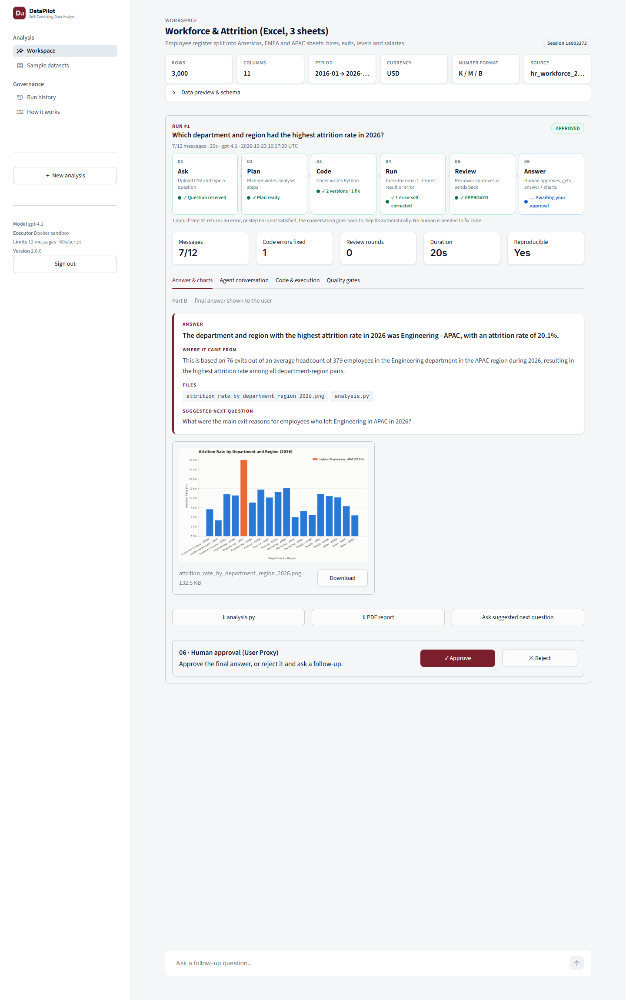
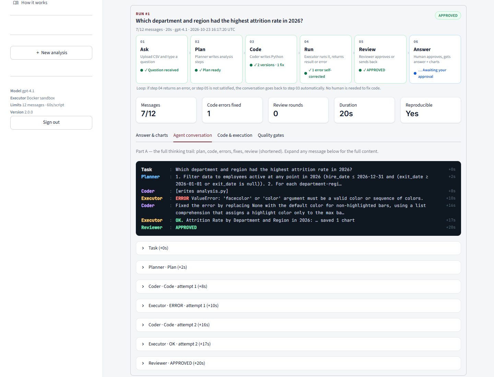
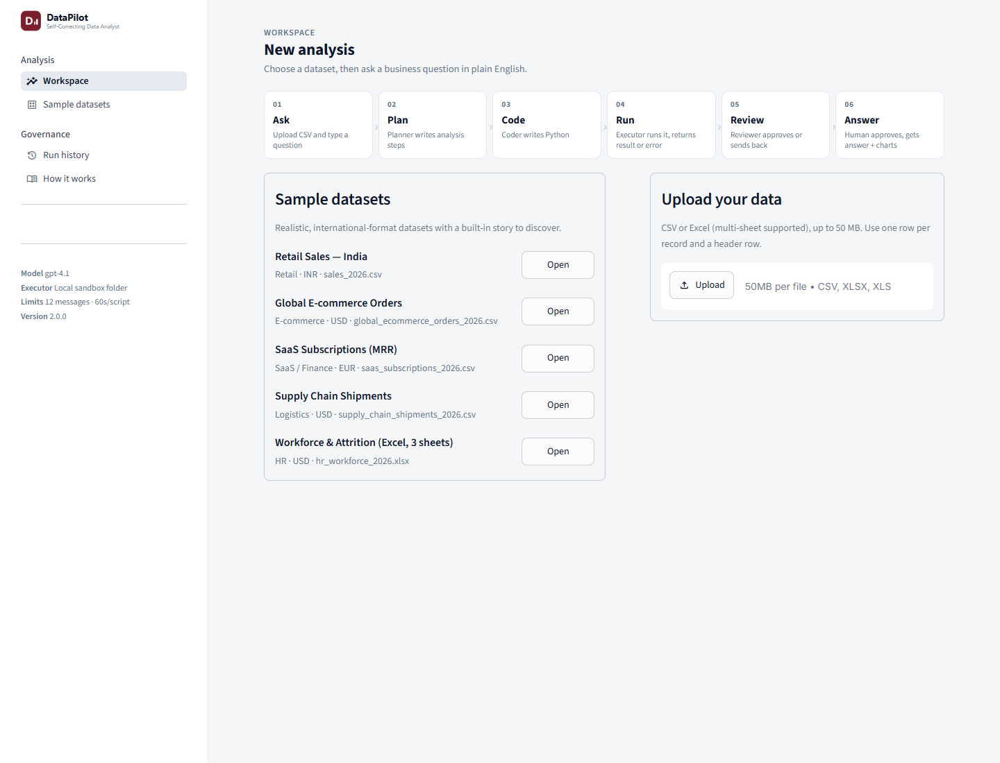
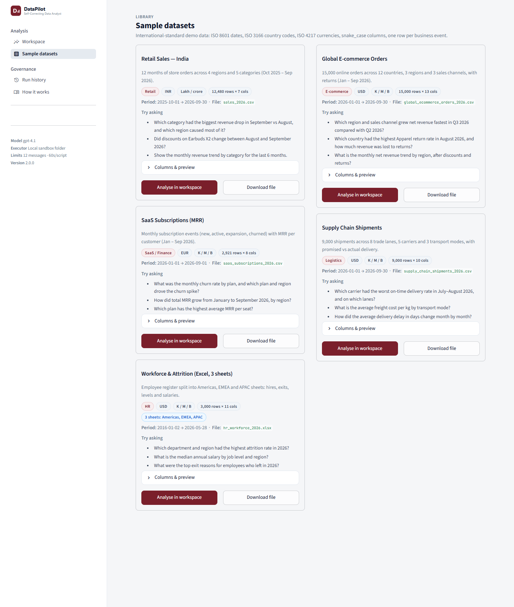

# 📊 DataPilot: Self-Correcting Data Analyst

Ask a business question in plain English. A team of **AutoGen** agents plans, writes Python,
runs it in a sandbox, **fixes its own errors**, gets reviewed, and returns the answer with charts.

Track 3 Agentic AI · AutoGen · Use case 03

## 🌐 Live demo
**https://datapilot.prasanna.digital**

- Hosted on a Hostinger VPS in Docker (app + isolated sandbox container) behind Traefik
- HTTPS with a Let's Encrypt certificate (auto-renewed); `http://` redirects to `https://`
- Access is password-protected (to protect the OpenAI budget). Ask the owner for access.
- Try it: **Use sample: sales_2026.csv** → **Ask the sample question** → watch the agents → **Approve answer** → ask a follow-up

```
01 Ask  ->  02 Plan  ->  03 Code  ->  04 Run  ->  05 Review  ->  06 Answer
                          ^             |            |
                          +---error-----+            |
                          +---feedback---------------+
```

## Screenshots
| Run: answer, live 6-step tracker, charts, human approval | Agent conversation (Part A) with a real self-corrected error |
|---|---|
|  |  |
| **New analysis** | **Sample datasets library** |
|  |  |

## Features
- **Enterprise UI (v2)**: Workspace, Sample datasets, Run history and How it works pages. Each run shows a **live 6-step tracker** (Ask → Plan → Code → Run → Review → Answer) that marks retries and errors, plus KPI tiles (messages used, errors fixed, review rounds, duration, reproducible) and four tabs: *Answer & charts* (Part B), *Agent conversation* (Part A transcript plus every full message), *Code & execution* (each attempt plus the final `analysis.py`), and *Quality gates* (the spec's Done checklist, evaluated on that run)
- **International reporting standards**: ISO 8601 dates, ISO 4217 currency codes, K/M/B or lakh/crore number formats per dataset (auto-detected from column names like `price_usd`), and a single house chart style with a colour-blind-checked palette
- **Planner / Coder / Executor / Reviewer** agents plus a human approval step (User Proxy)
- **Self-correction loop**: errors and reviewer feedback go back to the Coder automatically
- **Safety**: stops on `APPROVED` or after **12 messages**. Code runs in an isolated sandbox container with no API keys, no internet, a read-only FS and CPU/RAM limits, after a static safety check
- **Outputs**: written answer, PNG charts, re-runnable `analysis.py` (automatically re-run after approval to prove the numbers repeat), **one-page PDF report**
- **Follow-up questions** continue the same session (team state persisted in SQLite)
- **CSV and multi-sheet Excel** uploads (pick a sheet, or stack them all)
- `SelectorGroupChat` with deterministic routing (stretch goal); `TEAM_MODE=roundrobin` for the basic version

## Sample datasets
Five built-in datasets, each with a story to find and three sample questions (`data/sample/catalog.json`):

| Dataset | Domain | Rows | Currency / format | Story to find |
|---|---|---|---|---|
| `sales_2026.csv` | Retail (India) | 12,480 | INR · lakh/crore | Electronics fell most in Sep; South caused 54% |
| `global_ecommerce_orders_2026.csv` | E-commerce | 15,000 | USD · K/M/B | APAC Mobile App +61% in Q3; Germany Apparel returns spike in Aug |
| `saas_subscriptions_2026.csv` | SaaS / Finance | 2,921 | EUR · K/M/B | Pro-plan churn spike in EMEA after a May price rise |
| `supply_chain_shipments_2026.csv` | Logistics | 9,000 | USD · K/M/B | OceanLink on time only 54% in Jul–Aug on China export lanes |
| `hr_workforce_2026.xlsx` (3 sheets) | HR | 3,000 | USD · K/M/B | APAC Engineering attrition 20% |

Regenerate them with `python scripts/generate_sample_data.py` (deterministic, seeded).

## Project structure
```
frontend/            Streamlit UI: app.py (navigation), theme.py (design system), components.py,
                     views/ (workspace, samples, history, guide), state.py
backend/
  datapilot/         Agent engine: config, prompts, team, executors, safety, runner, report, cli,
                     progress (6-step tracker), quality (Done-checklist gates), formatting (standards), catalog
  sandbox/           Isolated code-execution service + Dockerfile
  tests/             pytest suite (replay model: no API key needed)
database/            SQLite schema + data access (sessions, runs, messages)
data/sample/         5 sample datasets + catalog.json
scripts/             generate_sample_data.py, smoke_test.py, push_env.py
PRPs/                Product Requirement Prompts (core + deployment)
docs/                ARCHITECTURE.md, DEPLOYMENT.md, TESTING.md
Dockerfile, docker-compose.yml   app + sandbox containers, Traefik labels
```

## Quick start (local, no Docker)
```bash
python -m venv .venv && .venv\Scripts\activate        # Windows  (source .venv/bin/activate on Linux/Mac)
pip install -r requirements.txt -r requirements-dev.txt
copy .env.example .env                                  # then set OPENAI_API_KEY
python -m pytest                                        # 41 tests, no API key needed
python scripts/smoke_test.py                            # scripted error -> fix -> APPROVED run
streamlit run frontend/app.py                           # http://localhost:8501
```
CLI with a real `UserProxyAgent`:
```bash
python -m backend.datapilot.cli data/sample/sales_2026.csv "Which category had the biggest revenue drop in September vs August, and which region caused most of it?"
```

## Production (Docker on the VPS)
```bash
cp .env.example .env    # set OPENAI_API_KEY, DOMAIN, SANDBOX_TOKEN, APP_PASSWORD
docker compose up -d --build
docker compose exec app python scripts/smoke_test.py
```
See [docs/DEPLOYMENT.md](docs/DEPLOYMENT.md).

## Test results (23 Oct 2026)

### Automated tests: 41 passed, no API key needed
| Suite | What it proves |
|---|---|
| `test_team_replay.py` | Full team with real code execution: buggy script → `KeyError` → Coder fixes it → APPROVED; 12-message limit; follow-up resumes the session; analysis.py is reproducible; PDF export; answer without the `APPROVED` line still stops |
| `test_selector.py` | Routing: error → Coder, ok → Reviewer, feedback → Coder, follow-up → Planner |
| `test_sandbox.py` | Code runs only in the session folder, can't see API keys, path traversal blocked, timeout enforced |
| `test_safety.py` | Static gate allows normal pandas/matplotlib code and blocks subprocess, env access, network, `exec`, outside paths |
| `test_data_loader.py` | CSV profile with date range, multi-sheet Excel (stacked or one sheet) |
| `test_progress_quality.py` | 6-step tracker states (live and finished), transcript lines, quality gates, chart-label audit, currency/number standards, sample catalog |

### Deployment checks (VPS)
| Check | Result |
|---|---|
| `app` and `sandbox` containers | ✅ healthy |
| Scripted smoke test inside Docker (`executor=sandbox`) | ✅ error → fix → APPROVED, reproducible |
| Sandbox has no internet / no `OPENAI_API_KEY` | ✅ blocked / not present |
| HTTPS certificate, HTTP→HTTPS redirect, HSTS | ✅ Let's Encrypt, 308 redirect, `max-age=31536000` |

### Live LLM runs (sample question on `sales_2026.csv`)
*Which category had the biggest revenue drop in September vs August, and which region caused most of it?*
Correct answer: **Electronics** (Rs 52.6 L → Rs 35.9 L, down Rs 16.7 L); **South** caused Rs 9.0 L of it (54%).

| Model | Runs | Outcome |
|---|---|---|
| `gpt-4o-mini` | 7 | Real self-correction seen (pandas MultiIndex `KeyError`, length mismatch, sign error caught by the Reviewer), but often hit the 12-message limit; 2 runs were approved with **wrong** answers |
| `gpt-4.1-mini` | 2 | Analysis grew beyond the question; hit the 12-message limit |
| **`gpt-4.1`** (default) | 2 | ✅ **Correct answer both times**, APPROVED in 5 messages (Planner → Coder → Executor → Reviewer), 2 labelled charts, analysis.py reproducible |

### Live runs on all five sample datasets (v2, `gpt-4.1`, Docker sandbox)
| Dataset | Question | Result |
|---|---|---|
| Retail — India | Biggest category drop Sep vs Aug, and which region? | ✅ Electronics INR 52.6 L → 35.9 L (−31.8%); South INR 9.0 L (54.0%) · 5 messages |
| Global e-commerce | Fastest-growing region + channel, Q3 vs Q2? | ✅ APAC / Mobile App +60.9% (USD 88.7K → 142.8K) · 5 messages |
| SaaS subscriptions | Monthly churn by plan; what drove the spike? | ✅ Pro plan, peak 2026-05, EMEA drove it · 5 messages |
| Supply chain | Worst on-time carrier in Jul–Aug, and lanes? | ✅ OceanLink 54.0%; CN → DE 22.4%, CN → US 27.0% · 5 messages |
| HR workforce (3-sheet Excel) | Highest attrition department + region in 2026? | ✅ Engineering, APAC 20.1% · **1 code error self-corrected** (matplotlib `ValueError`) · 7 messages |

All five were APPROVED, and the automatic re-run of `analysis.py` reproduced the same numbers each time.

Fixes made because of the live runs:
- The data profile now lists the date range and the months present, so the model doesn't guess the year.
- The Coder prompt now includes pandas conventions for month comparisons and drop signs.
- A complete Reviewer answer now counts as approval even if the final `APPROVED` line is missing.

Sample approved answer (gpt-4.1):
```
ANSWER
The category with the biggest revenue drop in September vs August was Electronics, with a decrease
of Rs 16.7 lakh. The South region caused most of this drop, contributing Rs 9.0 lakh to the decline.

WHERE IT CAME FROM
Electronics revenue fell from Rs 52.6 lakh in August to Rs 35.9 lakh in September. Within Electronics,
the South region's revenue dropped from Rs 13.8 lakh to Rs 4.8 lakh, accounting for over half of the decline.

FILES
category_revenue_change_sep_vs_aug.png, region_revenue_drop_for_category.png | analysis.py

SUGGESTED NEXT QUESTION
What products within Electronics in the South region saw the largest revenue declines from August to September?
```

## Done checklist
| | Requirement | Where |
|---|---|---|
| ✅ | Agents fix a code error on their own | `test_team_replay.py`, `smoke_test.py`, UI **ERROR → FIXED** badges |
| ✅ | Code runs only in the sandbox folder / Docker container | `backend/sandbox`, `safety.py` |
| ✅ | Stops on APPROVED or after 12 messages | `team.make_termination`, `test_stops_after_12_messages_without_approval` |
| ✅ | Re-running analysis.py gives the same numbers | UI *Reproducibility check*, `AnalysisSession.reproduce()` |
| ✅ | Every chart has title, axis labels, units | Coder rules + Reviewer checklist |
| ✅ | Human approval + follow-up in the same session | Approve/Reject buttons, chat follow-ups, CLI `UserProxyAgent` |

## Tech stack
AutoGen 0.7 (`autogen-agentchat`, `autogen-ext[openai]`) · OpenAI `gpt-4.1` · Streamlit · pandas · matplotlib · SQLite · fpdf2 · Docker · Traefik + Let's Encrypt
